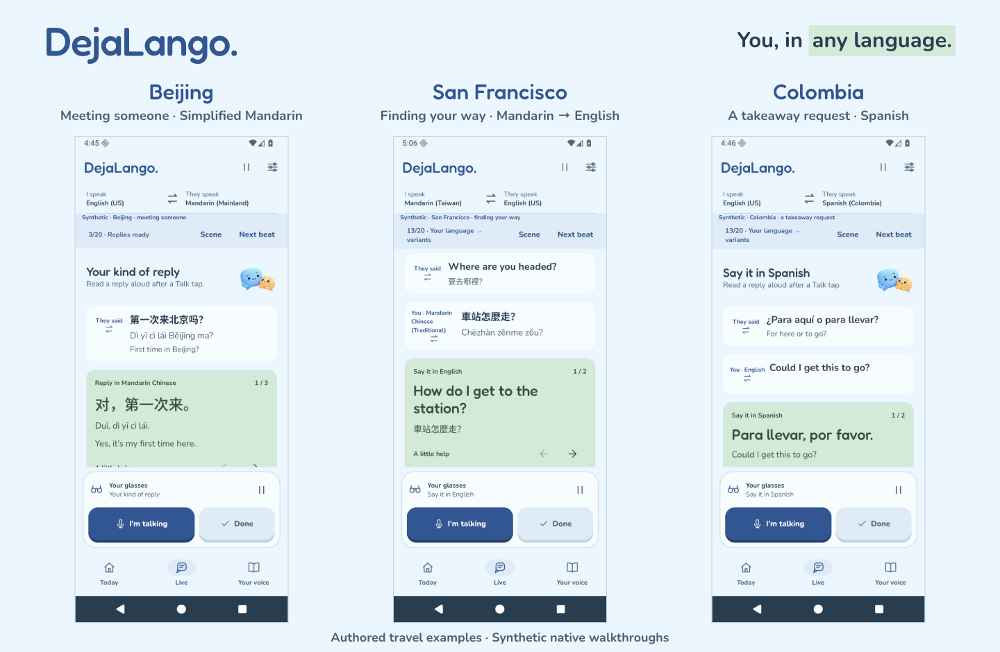
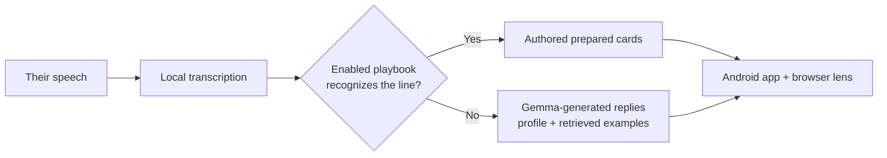
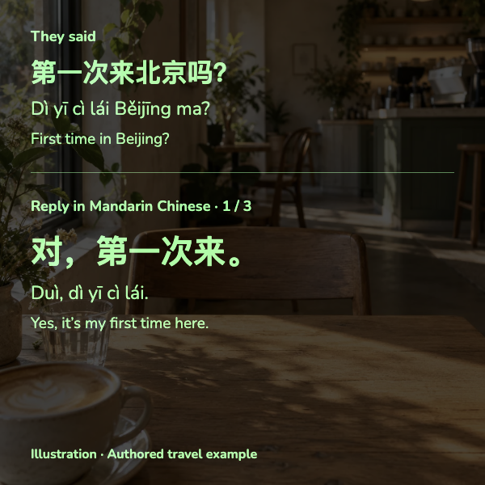

<div align="center">

# DejaLango

**Speak a new language in real conversations.**

See what they said and what to say back, in their language and your own voice.<br/>
Designed for glasses, with all inference on your phone. The demo uses a browser glasses simulator.

**Android prototype · Gemma 4 + EmbeddingGemma · Pixel 11 Pro XL**

[Why DejaLango](#why-dejalango) · [See the experience](#your-next-turn) · [Try it](#try-it) · [Device results](#measured-on-devices) · [Developer guide](docs/GETTING_STARTED.md)



<sub>Native app screens with authored, synthetic travel dialogue. Choose your own regional language pair.</sub>

</div>

## Why DejaLango

Language apps and translators can leave a gap at the moment that matters: answering a real person, in the moment, in your own words.

- **Practice needs a bridge to real life.** [Duolingo](https://blog.duolingo.com/video-call/) offers speaking practice and simulated conversations. DejaLango helps with the unexpected question from the person in front of you.
- **Understanding is only half the exchange.** [Google Translate](https://support.google.com/translate/answer/6142474?co=GENIE.Platform%3DAndroid&hl=en) provides live translation. DejaLango adds short replies in the other person's language, shaped around your wording, so you can say them yourself.
- **A conversation should survive a lost connection.** Cloud inference adds network round-trips and sends conversation data off the phone. DejaLango keeps inference and personal memory on the device.

## Your next turn

**DejaLango keeps you speaking.** Gemma 4 listens on your phone. After the other person finishes, the display shows their words, a translation, and two short replies in their language. Tap **I'm talking** to tell it whose turn it is, then read a suggested reply aloud. DejaLango can recognize the card you used. You can also start with your own thought and get ways to say it in their language.

Meet someone in Beijing. Find your way in San Francisco. Order food in Colombia:

| Situation and language pair | What you can do |
|---|---|
| **[Beijing](docs/images/native-beijing.png)**<br>English → Mandarin (Mainland) | **Follow a new acquaintance's question.**<br>第一次来北京吗？<br>*Dì yī cì lái Běijīng ma?*<br>“First time in Beijing?” See the meaning and choose a reply. |
| **[San Francisco](docs/images/native-san-francisco.png)**<br>Mandarin (Taiwan) → English (US) | **Ask for directions in English.**<br>車站怎麼走？<br>*Chēzhàn zěnme zǒu?*<br>Start in Mandarin and get “How do I get to the station?” to say aloud. |
| **[Colombia](docs/images/native-colombia.png)**<br>English → Spanish (Colombia) | **Make a request your way.** Start with “Could I get this to go?” and get “Para llevar, por favor.” as a way to express it in Spanish. |

Open a destination to inspect its full screen. These examples use the real native UI with authored dialogue; they demonstrate the interface rather than measured model output.

Current choices cover English (US, UK, Australia), Spanish (Colombia, Mexico, Spain), and Mandarin (Mainland, Taiwan). Choose the language you speak and the regional variety the other person speaks. Tap **Done** when you finish, or let a pause close audio capture. Recognition follows. Word hints can help during a pause, and a mistaken speaker assignment can be corrected and undone.

**Today** starts a conversation, **Live** follows the exchange, and **Your voice** builds a profile from your own words. Talk and Done stay in the same place across all three screens.

## Make the replies sound like you

Your voice means your wording: how formal you are, the phrases you reach for, and how you put a thought together. Add examples of your own sentences in **Your voice**. DejaLango stores a profile locally and retrieves relevant examples to help guide Gemma's generated suggestions.

The personal context comes from sentences you explicitly supply. Reading a suggested card does not automatically add it to your style samples.

## Prepared for familiar moments

Before a trip, add sentences to **Your voice** and choose a playbook for a likely situation: ordering coffee, haggling at a market, or taking a DiDi ride. The optional **debug playbook** checks the other person's line against prepared conversations before asking Gemma to write fresh replies.

When DejaLango recognizes a familiar line, it can show prepared reply cards sooner. An exact match can stop transcription early. A sufficiently clear semantic match can also reuse those cards. Unmatched lines continue to Gemma for generated replies.

In recorded Pixel 11 scene runs, prepared cards appeared in roughly **1–3 seconds**, compared with **5–8 seconds** for newly generated replies. These are fixture results with the scene index ready; [device results](#measured-on-devices) give the measured ranges and sources.

The current pack contains **five Beijing scenes**: restaurant lunch, café ordering, market bargaining, a DiDi ride, and café small talk. It supports **English (US) → Mandarin (Mainland)** in debug builds and is **off by default**. These prepared replies are authored ahead of time; personalization guides the separate generated-reply path.

[Try the playbook](docs/GETTING_STARTED.md#try-the-prepared-playbook) for setup, readiness and display details.

## Try it

**Explore the interface first.** The native walkthrough needs an Android emulator, a full **JDK 25** with `jlink`, and **Android SDK 36** with `adb`. Set `ANDROID_HOME`, or set `sdk.dir` in `local.properties`, to your SDK's path. Use the bundled Gradle wrapper.

```sh
git clone https://github.com/Wenjix/DejaLango.git
cd DejaLango

./gradlew :app:assembleMobileDebug \
  -PwithLiteRtLm=false -PwithTensorNpu=false -PwithQualcommNpu=false

# Replace EMULATOR_SERIAL with your running emulator's serial, e.g. emulator-5554.
adb -s EMULATOR_SERIAL install -r app/build/outputs/apk/mobile/debug/app-mobile-debug.apk
adb -s EMULATOR_SERIAL shell am start -n \
  dev.dejalango/dev.dejalango.app.ui.CompanionWalkthroughActivity
```

Use **Next beat** and **Scene** to explore the labelled synthetic walkthrough. It runs no inference, requests no microphone and saves no profile. Its bundled restaurant fixtures cover four regional pairs; the gallery above uses separate authored travel examples in the same UI.

**Run real conversations:** [install the phone app and models](docs/GETTING_STARTED.md#run-real-models-on-a-phone).<br/>
**Explore prepared replies:** [enable a debug playbook scene](docs/GETTING_STARTED.md#try-the-prepared-playbook).<br/>
**See the optional display:** [connect the browser lens](docs/GETTING_STARTED.md#open-the-browser-lens).

## Measured on devices

Built for the **Google Gemma Hardware Hackathon at AGI House, October 24, 2026**. Gemma 4 E2B and EmbeddingGemma 2 have run locally on Pixel devices with Tensor G5 and G6. The current evidence includes these recorded fixture runs:

| Reply path | Device | Observed time from turn end |
|---|---|---|
| [Exact playbook match](https://github.com/Wenjix/DejaLango/pull/9) | Pixel 11 Pro XL · Tensor G6 | **0.9–1.9 s** to prepared cards |
| [Semantic playbook match](https://github.com/Wenjix/DejaLango/pull/9) | Pixel 11 Pro XL · Tensor G6 | **1.9–2.8 s** to prepared cards |
| [Generated Beijing replies](https://github.com/Wenjix/DejaLango/pull/11) | Pixel 11 Pro XL · Tensor G6 | **5.1–7.9 s** to new cards |
| [Generated Companion replies](https://github.com/Wenjix/DejaLango/pull/4) | Pixel 10 Pro XL · Tensor G5 | **8.4 s median** to replies; **2.9 s median** to transcript; replies on **4 of 5 turns** |

Playbook figures were recorded after the social-scene index was ready; the Pixel 10 figures use a separate conversation replay. The linked records identify inputs, builds, misses and cancellations. The first two paths reuse authored cards; the generated paths write new text. The [earlier TPU/GPU findings](docs/FINDINGS.md) document the previous pipeline separately.

Host checks cover turn ownership, routing, parsing, playbook matching and storage. Android checks cover the native UI, startup, HUD access, voice ownership and model/fixture paths. [Run the checks](docs/GETTING_STARTED.md#run-checks) to verify your build.

## Inside the app

A pure Kotlin engine coordinates turns and publishes shared conversation state. **Gemma 4 E2B** handles audio and generated replies. **EmbeddingGemma 2** retrieves relevant examples of your wording and checks semantic playbook matches.

| Tech stack | Role |
|---|---|
| Kotlin + Jetpack Compose | Native Android app, developed on a Pixel 11 Pro XL with Tensor G6 |
| Gemma 4 E2B + EmbeddingGemma 2 through LiteRT-LM | Local audio, text and retrieval, with Tensor TPU acceleration; audio encoding uses CPU |
| Silero VAD + ONNX Runtime | Detect speech and pauses |
| Room + DataStore | Store your sentences, voice profile and settings on the phone |
| NanoHTTPD | Local HUD server feeding the display, shown in a browser glasses simulator for the demo |
| ElevenLabs, during demo preparation | Prerecorded test voices for the demo soundboard; no ElevenLabs calls at runtime |

Both models have run on the Pixel 11's TPU; GPU/CPU fallback supports other configurations. Once the app and model weights are installed, conversation inference works offline, including in airplane mode. The simulator can connect over USB. Downloads and ElevenLabs test-voice preparation happen beforehand; soundboard tooling and audio are not included in this repository.

For the other person's turn:



The Talk control supplies turn ownership, so the model has less to infer. Inference runs on the phone. The optional local HUD bridge shares conversation state with a connected browser, using USB forwarding by default; LAN access is an explicit setting. Simulator camera video stays in the browser.

<details>
<summary><b>See the Beijing example on the browser lens</b></summary>

<p align="center"></p>

Illustrative display of the authored dialogue. A 600 × 600 green browser renderer is implemented; dedicated glasses and spatial renderers are future work. The current Companion build's tokenized phone-to-browser path still needs a device recheck.

</details>

## Next

- **After-conversation lessons** that replay how you could have answered and teach the words you missed.
- **Dedicated on-device speech-to-text** to reduce recognition latency, with sub-second replies as a target.

These are future work. The current app uses Gemma for transcription and does not generate lessons from your conversations.

## Developer documentation

| Start here | What you'll find |
|---|---|
| [Getting started](docs/GETTING_STARTED.md) | Emulator preview, real models, prepared scenes, browser lens and tests |
| [Current architecture](docs/ARCHITECTURE.md#0-current-companion-path) | Turn ownership, local model coordination, playbook routing and HUD state |
| [Device findings](docs/FINDINGS.md) | Dated measurements and inference bottlenecks |
| [Demo notes](docs/DEMO.md) | Rehearsal, playbook presentation and recovery |
| [Visual sources](docs/images/README.md) | Authored scenarios, native captures and illustration provenance |
| [Third-party notices](THIRD_PARTY.md) | Dependencies, fonts and asset origins |

[`engine/`](engine) owns conversation logic. [`app/`](app) supplies the native UI, microphone, inference adapters, storage and HUD bridge. [`scripts/`](scripts) handles models, forwarding and trace export.

## License

Copyright © 2026 Wenjie Fu. DejaLango is free software under the GNU Affero General Public License,
version 3 only (AGPL-3.0-only); see [LICENSE](LICENSE). If you share a modified version, or run one
that people use over a network, you must offer them its source under the same license.
Third-party components keep their own licenses ([THIRD_PARTY.md](THIRD_PARTY.md), with full texts
in [`licenses/`](licenses/)), and the Gemma weights are covered by the Gemma Terms of Use.
